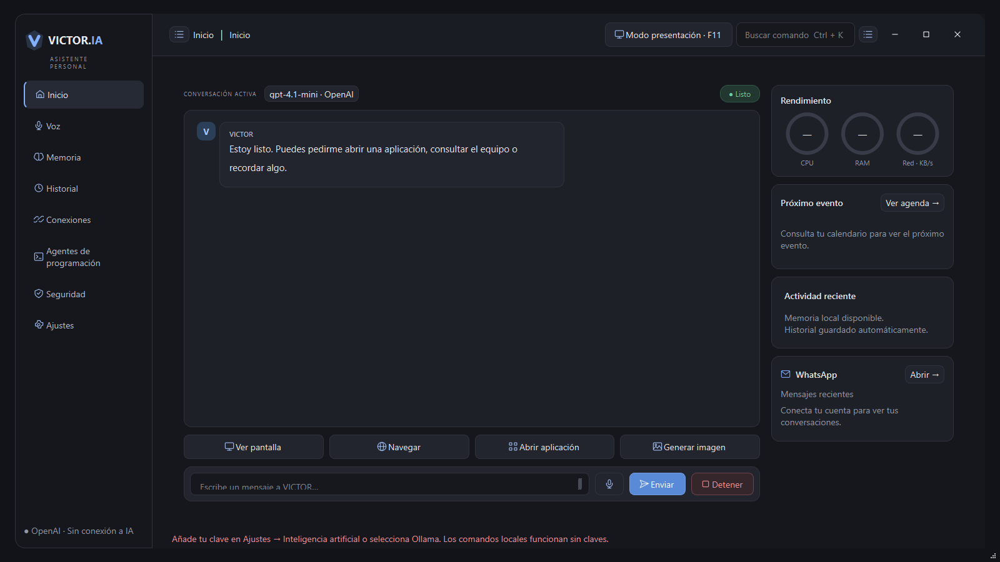

# VICTOR.IA

Asistente de escritorio para **Windows 10/11 de 64 bits**. Combina conversación con IA, herramientas supervisadas del PC, voz, música, conexiones y agentes de programación en una interfaz Grafito.

[**Descargar la última versión**](https://github.com/NTMatias/VICTOR-IA/releases/latest) · [**Todas las versiones**](https://github.com/NTMatias/VICTOR-IA/releases) · [**Historia y avances**](docs/HISTORIA.md)



## Descargar y abrir

Para usarlo sin instalar Python ni VS Code, descarga `VICTOR_IA_v7.0.0_Windows_x64.zip` del release 7. Extrae **toda** la carpeta en el Escritorio o en otra carpeta local NTFS y abre **ABRIR VICTOR.bat**. **COMPROBAR VICTOR.bat** revisa el entorno incluido. Puedes transportar el ZIP en una USB y extraerlo en la PC de destino.

El portátil incluye Python 3.12, bibliotecas, navegador integrado y Whisper base. Internet es necesario para servicios online. No contiene claves, cuentas, conversaciones ni contactos personales. Claude Code requiere Git Bash instalado en Windows. No ejecutes la aplicación dentro del ZIP.

## Qué incluye la versión 7

| Área | Funciones |
| --- | --- |
| Conversación | Streaming, Markdown, historial y memoria local; OpenAI, Anthropic, Gemini y Ollama. |
| Voz | Whisper local o transcripción OpenAI con clave; activación por «VICTOR», petición tras saludo, interrupción, reducción de ruido/eco y volumen progresivo de música. |
| Spotify | Reproductor integrado, carátula, biblioteca, búsquedas, controles y coincidencia aproximada por título y artista. |
| WhatsApp | Página oficial integrada con la paleta Grafito, vinculación QR y conversaciones recientes en Inicio. |
| Google y Telegram | Gmail, Calendar y Drive con OAuth; Telegram con autorización de usuarios. |
| Control remoto | Emparejamiento local HTTPS por QR, pantalla, ratón táctil y teclado incremental. |
| Imágenes | Elección OpenAI/Gemini, generación cancelable, visualización en el chat, historial, ampliar y guardar. |
| Programación | Secciones Codex y Claude Code con terminales de sus CLIs oficiales, selección de proyecto y herramientas propias de cada agente. |
| Escritorio | Abrir aplicaciones, archivos, búsquedas, volumen y capturas, con confirmaciones según el riesgo. |

## Configurar tus servicios

Abre **Ajustes → Inteligencia artificial**. Guarda las claves de los proveedores que quieras utilizar; las claves introducidas en la interfaz se protegen localmente mediante Windows DPAPI. También puedes usar `.env` siguiendo `.env.example`; ese archivo es texto local y no debe compartirse.

- **OpenAI:** clave API o conexión oficial de cuenta ChatGPT cuando la cuenta y el servicio sean elegibles. Los modelos disponibles se consultan; no todos están disponibles para todas las cuentas. [Panel API oficial](https://platform.openai.com/api-keys).
- **Gemini:** exclusivamente API key. [Obtener clave en Google AI Studio](https://aistudio.google.com/apikey). No incluye inicio de sesión Google mediante Gemini CLI.
- **Anthropic:** clave API. [Claude Console](https://platform.claude.com/).
- **Ollama:** servidor local instalado y modelo descargado por el usuario; no necesita clave API.

Generar imágenes requiere una **clave API propia con permisos y cuota**, aunque uses cuenta ChatGPT para conversar. La prueba real de Gemini durante el desarrollo devolvió un error 429 de cuota; no se presenta como una generación exitosa. Los servicios pueden cobrar según sus condiciones. Spotify integrado necesita Premium y configuración OAuth. Gmail/Calendar/Drive necesitan un cliente OAuth de Google independiente de Gemini. WhatsApp se vincula desde su QR oficial.

En el portátil, la voz empieza en modo manual y sin escucha automática. Para activación por nombre, prepara el micrófono y selecciona escucha continua. La reducción de ruido y eco depende del hardware y la posición de los altavoces; no garantiza reconocimiento perfecto.

## Ejecutar desde el código fuente

1. Instala Python 3.12 x64 en Windows y descarga el ZIP de fuentes o clona el repositorio.
2. Ejecuta `instalar.bat`. Instala dependencias y compila los hosts de Spotify y WhatsApp desde C# y un SDK WebView2 oficial con SHA256 verificado.
3. Asegúrate de tener [WebView2 Runtime oficial](https://developer.microsoft.com/microsoft-edge/webview2/) instalado.
4. Ejecuta `iniciar.bat` y configura tus servicios. Whisper se descarga desde el panel de preparación de voz.

Para los agentes, instala Node.js LTS y Git para Windows/Git Bash. Ejecuta en la raíz del proyecto:

```powershell
npm install --prefix data/agent_cli --ignore-scripts --no-audit --no-fund @openai/codex@0.162.1 @anthropic-ai/claude-code@2.1.197
```

Los ejecutables oficiales mantienen sus propios permisos y autenticación. Cada usuario conecta su cuenta o clave desde el flujo oficial; VICTOR no incluye credenciales de los agentes ni saldo. Para construir solo los hosts:

```powershell
.venv\Scripts\python.exe tools\build_webview2.py
```

## Versiones e historia

Hay **siete releases descargables**, desde v1.0.0 hasta v7.0.0. Las versiones 1–6 se importaron de sus ZIP reales conservados. Sus commits se crearon al publicar; no se simulan fechas originales. Cada etiqueta permite consultar el código exacto publicado para esa etapa y cada release destaca sus avances. Los ZIP históricos requieren el entorno descrito en su documentación y sus servicios externos pueden haber cambiado.

[Historia por etapas](docs/HISTORIA.md) · [Changelog](CHANGELOG.md) · [Procedencia y hashes de las copias originales](docs/SNAPSHOTS.json) · [Registro detallado de desarrollo](docs/REGISTRO_DESARROLLO.md).

## Verificación y datos locales

Consulta [VERIFICACION.md](VERIFICACION.md) para distinguir pruebas automatizadas, fixtures y comprobaciones reales. Las pruebas que necesitan servicios externos son optativas; el resto no envía mensajes ni usa cuentas personales.

`.env`, `data/`, `workspace/`, sesiones, bases de datos, cachés, entornos y binarios compilados están excluidos de Git. El portátil distribuye dependencias separadas del historial del código. Revisa [avisos de terceros](THIRD_PARTY_NOTICES.md). VICTOR.IA es un proyecto independiente y no está afiliado a los proveedores integrados.
